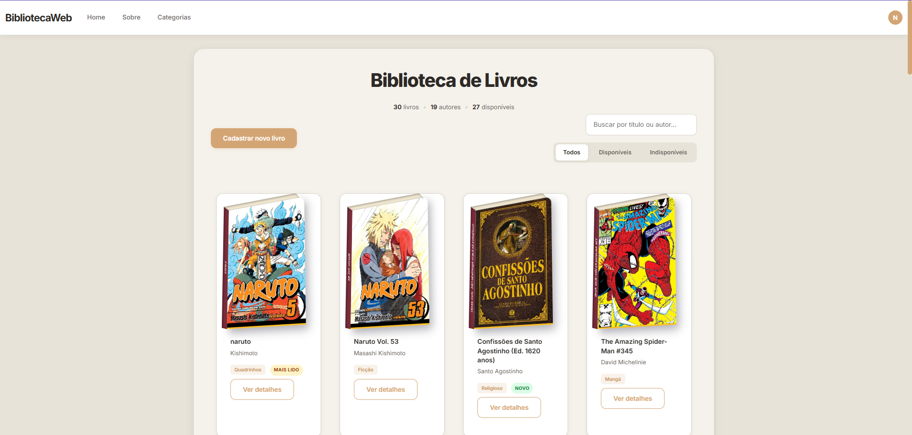

# BibliotecaWeb

Catálogo de livros, mangás e HQs feito em **ASP.NET Core MVC** com **SQL Server**, publicado na nuvem (Azure). As capas aparecem como livros em 3D (CSS puro), dá para cadastrar com upload de imagem e reorganizar o grid arrastando os cards.

**Demo:** https://bibliotecaweb-op-2026-dgahgfhwhbdzczed.westus3-01.azurewebsites.net/
> O site roda em plano gratuito. Se ficar um tempo sem acessos, o primeiro carregamento pode demorar alguns segundos (cold start).



## Funcionalidades

- Listagem em grid com capas em 3D, feitas só com CSS (`perspective`, `rotateX/rotateY`)
- Cadastro de livro com **upload de capa** (`IFormFile`) e capa genérica quando não há imagem
- Página de detalhes, edição (mantendo a capa atual se nenhuma nova for enviada) e exclusão
- **Reordenação por drag-and-drop** com SortableJS, salva no banco via `fetch` + endpoint POST
- Barra de estatísticas calculada a partir dos dados reais (total, autores, disponíveis)
- Layout responsivo com Bootstrap + CSS customizado

## Tecnologias

- C# / .NET 8, ASP.NET Core MVC (Controllers, Views Razor)
- SQL Server / Azure SQL Database, acesso com **ADO.NET** (`Microsoft.Data.SqlClient`) e consultas parametrizadas
- HTML, CSS, JavaScript, Bootstrap, SortableJS
- Deploy: Azure App Service + Azure SQL Database (planos gratuitos)

## Estrutura

```
BibliotecaWeb/
├── Controllers/LivroController.cs   # actions: Index, Criar, Detalhes, Editar, Atualizar, Deletar, ReordenarLivros
├── Models/Livro.cs
├── LivroRepository.cs               # acesso ao banco (ADO.NET)
├── Views/Livro/                     # Index, Criar, Detalhes, Editar
├── wwwroot/css/site-custom.css      # visual do projeto (inclui o efeito 3D dos livros)
├── wwwroot/imagens/                 # capas
└── database/
    ├── schema.sql                   # criação da tabela
    └── seed-livros.sql              # livros de exemplo
```

## Como rodar localmente

1. Instale o **.NET 8 SDK** e um SQL Server (Express serve).
2. Crie um banco chamado `BibliotecaDB` e rode, nesta ordem, `database/schema.sql` e `database/seed-livros.sql`.
3. Ajuste a connection string em `appsettings.json`:
   ```json
   "ConnectionStrings": {
     "BibliotecaDB": "Server=localhost;Database=BibliotecaDB;Trusted_Connection=True;TrustServerCertificate=True;"
   }
   ```
4. Rode o projeto (`dotnet run` ou F5 no Visual Studio).

Em produção, a connection string fica em **App Service → Configuration → Connection strings** (nome `BibliotecaDB`), então nenhuma credencial vai para o repositório.

## Limitações conhecidas

- A busca e as abas de filtro (Todos / Disponíveis / Indisponíveis) ainda são só visuais, sem lógica
- Os uploads ficam em `wwwroot/imagens` e são apagados a cada novo deploy. O ideal em produção seria um armazenamento externo (por exemplo, Azure Blob Storage)
- Livros recém-cadastrados aparecem no começo da lista até serem reordenados (a coluna `Ordem` fica nula)
- Sem autenticação: qualquer pessoa com o link pode cadastrar, editar e excluir

## Próximos passos

- Implementar busca e filtros de verdade
- Injeção de dependência no repositório (hoje os métodos são estáticos)
- Autenticação (ASP.NET Identity ou JWT)
- Migrar uploads para Blob Storage

## Autor

Feito por **Neto Santos **, como projeto de estudo e portfólio em .NET.
